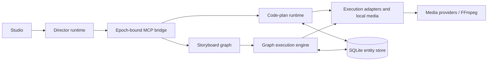

# OpenSlate

OpenSlate is a local video studio with a conversational Director, storyboard editing and an optional TypeScript code plan. The browser, server, SQLite database, media and workers run on one computer; the selected language and media models can use cloud services. It is an early single-user application; see [current status](docs/implementation/STATUS.md) for verification and limits.

## Features

**Making a film**

- **Storyboard:** develop brief → scenes → shots, generate keyframes and voice lines, inspect the returned frames and video recipe, then confirm scene video. Edit individual shots, fit measured narration, select earlier keyframes and export in storyboard order.
- **Code plan (experimental):** the Director submits a complete program. A durable journal reuses unchanged media, waits for choices and confirms each declared shot's keyframe/video input. Plans can generate references, clips, speech and music, inspect clip frames, and render cuts with trims, speed, holds, fixed zoom, captions and sound effects.
- Imports and composer attachments become owned media. Code-film Directors can find uploaded pictures on later turns, inspect them and use bounded copies as generation references. Video/audio attachments have more limited later-turn availability.

**The Director**

- Native **Codex 0.162.1**, default **`gpt-6.1-sol`**, with other model IDs supplied by the installed runtime/account. Saved model selections are preserved. Director turns use high reasoning effort.
- Optional **Claude Code** for code-plan films: **Opus 5.5** (`claude-opus-5-5`) or **Sonnet 5.5** (`claude-sonnet-5-5`) on the user's Claude subscription. Storyboard films use Codex or the scripted demo Director.
- The Director reads project evidence and proposes changes through validated MCP tools. Storyboard notes/proposals and code-plan submissions have different contracts. It cannot run shell commands, browse the web, read arbitrary files or obtain provider keys through those tools. Code films permit generation within their saved plan and spend limit; storyboard media uses the scene decisions above. The Director can inspect pictures/contact sheets, but cannot listen to the soundtrack.

**Media models**

- Codex images use the separate pinned native image worker and ChatGPT login. OpenAI API images are also implemented.
- Viggle H3 supports reference, first-frame, first/last-frame and text modes in code films. Direct MiniMax H3 is also implemented.
- Gemini **Lyria 3.5** supplies code-film background music; OpenAI supplies speech and transcription. Transcripts are candidate evidence, not automatically accepted narration.
- Seedance on ModelArk and fal Kling/Veo/Wan adapters are built for code films; real use needs the relevant keys, installed profiles and account access. Availability in code is separate from live validation.

**Studio UI**

- The Last Ferry interface in `apps/web/src/next` is the only UI: **Plan / Keyframes / Assets / Film**, Start and Settings. Code films put keyframes and reference progress in Plan and Assets; their Code view appears only in Developer mode.
- English and Simplified Chinese, explicit @ scene/shot scope, image/video viewers, visible making/queued/held progress, Stop and saved-request recovery.
- Settings separates media and Director selection, voices, language and this computer. Code-film spending includes charged, possibly charged and in-flight work; the new-film default is **$4**, with a browser preference override. Raising/lowering a film's limit cannot erase existing liability. Storyboard execution has no project spend cap.

## Technical architecture

| Workspace | Responsibility |
|---|---|
| `packages/core` | Shared contracts, public browser types, workflow predicates, graph compiler and tool catalogs |
| `packages/director` | Codex/Claude/fake runtimes, instruction locks, MCP bridge and native image worker |
| `packages/providers` | Registered media adapters and bounded vendor transports |
| `apps/server` | Fastify API, application authority, SQLite, Director supervision, code-plan replay, execution and local media |
| `apps/web` | Vite/React studio; browser imports `@openslate/core/public` |
| `skills/` | Immutable storyboard guidance releases and separate code-plan instructions/API/example |
| `scripts/` | Local launcher, toolchain setup, offline demos, tests, browser harness and skill releases |



A human message is saved before a leased Director turn receives its locked guidance, current evidence and tools. The bridge validates scope, epochs and arguments. Storyboard changes compile restricted declarations to a graph without running the declarations as JavaScript. Code films instead strip TypeScript and evaluate the program **inside a disposable QuickJS/WASM worker**, with bounded JSON `ctx` calls, no Node/filesystem/network APIs, CPU/heap/stack limits and a deterministic clock/random sequence. Replay starts a fresh interpreter, reuses content-addressed results and waits for pending effects/choices. Host execution retains submission intent before provider calls; unknown outcomes reconcile their original identities.

Codex runs the pinned App Server with an exact local permission/configuration policy, a studio-owned instruction workspace and only the locked bridge catalog. Setup and each launch check the runtime; OpenSlate trusts the installed sandbox rather than claiming independent code-host/authentication isolation.

Claude Code runs a fresh noninteractive process on the user's Claude plan, with built-in tools disabled, an explicit MCP configuration and verified initialization. Its system prompt is supplied through a private file; output returns over bounded stream JSON.

The fake Director supplies scripted turns for offline fixtures and tests, without a native model call. [Runtime details](docs/technical/DIRECTOR-RUNTIME.md).

`openslate.sqlite` stores project heads, versioned JSON entities, commands and events. One data directory contains the database, owned artifacts, raw outputs/receipts, normalized media and instruction snapshots. Use one fixed absolute `OPENSLATE_DATA_DIR`; defaults otherwise depend on the launch directory. Schema 4 is created only in an empty database; other schema versions require a new directory. [Persistence and recovery](docs/technical/DATA-PERSISTENCE.md).

## Getting started

Application startup supports **Node >=24 <25**. Development/CI pins **Node 24.15.0** (`.nvmrc`), **pnpm 10.33.0** (`package.json`) and **FFmpeg/ffprobe 8.1.1** (`scripts/test-media-toolchain.json`).

```sh
nvm install
nvm use
npm install --global pnpm@10.33.0
pnpm install --frozen-lockfile
pnpm setup:test-media
pnpm check:toolchain
```

For a real Director or Codex images, install **`@openai/codex@0.162.1`** side by side and sign in using the [pinned installation instructions](docs/implementation/MANUAL-LIVE-PRODUCTION.md#codex). Claude Code is optional: the adapter accepts **2.1.312 or later 2.x**, with a local Claude subscription login. Neither a Codex account nor a Claude plan supplies the other vendors' media credits.

Configure the server locally; the launcher loads private `.env.live.local`, preserving exported variables. The names below come from the [setup](docs/implementation/LOCAL-SETUP.md) and [provider activation](docs/implementation/MEDIA-EXECUTION-LAUNCHER.md) guides; credentials never enter plans or browser code.

| Purpose | Environment variable names |
|---|---|
| Installation/media tools | `OPENSLATE_DATA_DIR`, `OPENSLATE_PROVIDER_CONFIG`, `OPENSLATE_FFMPEG`, `OPENSLATE_FFPROBE` |
| Director/image binaries | `OPENSLATE_CODEX_BINARY`, `OPENSLATE_CODEX_IMAGE_BINARY`, `OPENSLATE_CODEX_IMAGE_HOME`, `OPENSLATE_CLAUDE_BINARY` |
| Media credentials | `OPENSLATE_OPENAI_API_KEY`, `OPENSLATE_VIGGLE_API_KEY`, `OPENSLATE_MINIMAX_API_KEY`, `OPENSLATE_GEMINI_API_KEY`, `OPENSLATE_MODELARK_API_KEY`, `OPENSLATE_FAL_API_KEY` |
| Optional route switches | `OPENSLATE_ENABLE_IMAGE_GENERATION`, `OPENSLATE_ENABLE_CODEX_IMAGE_GENERATION`, `OPENSLATE_ENABLE_VIGGLE_H3_GENERATION`, `OPENSLATE_ENABLE_H3_GENERATION`, `OPENSLATE_ENABLE_SPEECH_GENERATION`, `OPENSLATE_ENABLE_TRANSCRIPTION`, `OPENSLATE_ENABLE_MUSIC_GENERATION`, `OPENSLATE_ENABLE_SEEDANCE_GENERATION`, `OPENSLATE_ENABLE_FAL_VIDEO_GENERATION` |

Configured credentials normally enable their routes; explicit `0` disables them. Protected result downloads use the exact host lists documented in the activation guide. Demo profiles require no keys.

```sh
export OPENSLATE_DATA_DIR="$HOME/openslate-data"
node scripts/start-local.mjs --no-open
```

Use that same directory for every restart. The production studio serves `http://127.0.0.1:3001`; pair using the launch link printed by the server. Stop it in its own terminal with Ctrl+C. [Launcher options](docs/implementation/LOCAL-LAUNCHER.md) explain reconnect and `--restart`.

For safe UI work, run `pnpm studio:fixture --film last-ferry` on **3101**, and `pnpm --filter @openslate/web dev` in a second terminal after building packages. Vite on **5173** proxies `/api` to 3101 unless `OPENSLATE_API_ORIGIN` overrides it. The server seed uses disposable fake media; `?fixture=last-ferry` is a separate browser-only simulation.

## Testing

| Command | Verification |
|---|---|
| `pnpm test` | Builds all five workspaces, then runs isolated offline Node tests; loopback listeners must be allowed |
| `pnpm typecheck` | Builds shared packages and typechecks all workspaces |
| `pnpm demo:code` | Offline HTTP/Director/code-plan/replay/restart proof with fake providers |
| `pnpm demo:headless` | Offline storyboard scoped-edit/restart proof |
| `node scripts/browser-check.mjs` | Rendered browser scenarios against disposable fixtures; run after a build, only where Chrome launching is supported |

The owner walkthrough is [测试说明](docs/ai/code-plan/TEST-INSTRUCTIONS.md); real-provider tests are [separately scoped](docs/implementation/MANUAL-LIVE-PRODUCTION.md). Card sandboxes must leave browser launching to the lead under [RULES.md](docs/ai/uiux-plan/codex/RULES.md). Fake tests, native model turns and real media acceptance are separate evidence.

## Documentation

- [Documentation map](docs/README.md), [architecture](docs/design/README.md) and [technical references](docs/technical/README.md).
- [Current status](docs/implementation/STATUS.md), [setup](docs/implementation/LOCAL-SETUP.md), [backup/recovery](docs/implementation/INSTALLATION-RECOVERY.md) and [remaining work](docs/design/IMPLEMENTATION-PLAN.md).
- [Code-plan design](docs/ai/code-plan/DESIGN.md), [film-quality results](docs/ai/film-quality/RESULTS.md) and [AI design/decision archive](docs/ai/README.md).
- [Contributing](CONTRIBUTING.md). [MIT license](LICENSE); third-party services and model weights retain their own terms.
