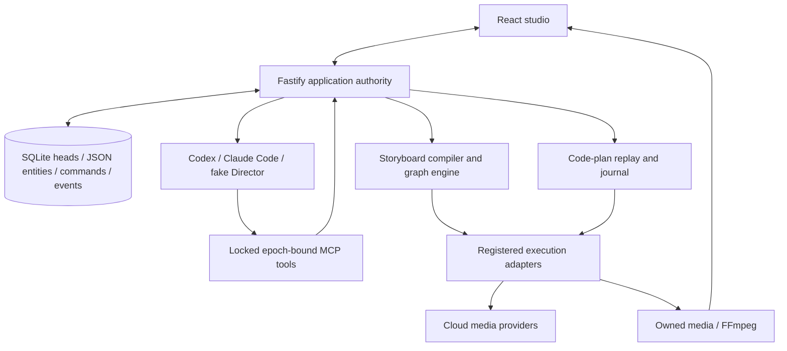

# OpenSlate architecture

OpenSlate is a single-user studio running on one computer: React browser UI, Fastify server, SQLite, owned media, workers and native Director processes. Cloud model/media APIs remain supported. The local rendering boundary is up to six minutes; that limit is not evidence of six-minute real-provider quality.

## Two film modes

| Mode | Planning and execution | Human decisions |
|---|---|---|
| Storyboard (`graph`, default) | Canonical brief/scenes/shots and restricted declarations compiled to an immutable operation graph; graph workers use candidates, grants, attempts and bindings | Make keyframes/voice, inspect returned frames and actual video recipe, then confirm scene video. Notes/proposals are separate typed decisions |
| Code plan (`code`, experimental) | Director submits a full TypeScript program; disposable QuickJS/WASM passes call bounded host methods and reuse content-addressed journal results | Program choices, each declared shot's keyframe/video-input confirmation and a per-film liability ceiling (new default $4) |

Models propose validated changes; application authority stays in OpenSlate. Storyboard declaration compilation never executes generated JavaScript. Code films do evaluate stripped TypeScript, only inside an isolated guest without Node/filesystem/network/secrets. New user direction fences incompatible old epochs, and neither mode can reuse a later request's authority for an earlier preparation.

## Components

| Path | Owns |
|---|---|
| `packages/core` | Data/public browser contracts, workflows, graph/compiler predicates and tool catalogs |
| `packages/director` | Codex/Claude/fake conversation adapters, locked instructions, bridge and separate native image worker |
| `packages/providers` | Fixed registered media contracts/transports |
| `apps/server` | Requests/authority, supervision, SQLite, graph/code execution, media validation/rendering and recovery |
| `apps/web/src/next` | The only UI, normalized server projections and authenticated human commands |
| `skills`, `scripts` | Immutable runtime guidance; launch/test/demo/toolchain/release operations |

## Turn and execution flow

1. Save a human message, its explicit scope and request-owned holds; lease a Director turn with an exact tool/guidance lock.
2. Supply canonical evidence/attachments and current source or storyboard context. Codex 0.162.1 defaults to `gpt-6.1-sol` at high effort; actual alternative models come from the local account/runtime. Claude Code supports Opus 5.5/Sonnet 5.5 for code films on the user's Claude plan. The fake Director supports offline fixtures.
3. Validate every MCP call under its original epoch. Storyboard changes prepare/apply atomically against revisions; code submissions dry-run and publish only against the matching base version.
4. Graph workers or code-plan execution admit current work under provider readiness, scope/Stop/holds, exact saved inputs and the mode's review/ceiling rules. Persist submission intent before irreversible effects.
5. Retain raw observations, normalized owned bytes, measurements and immutable receipts. Unknown submission requires lookup/reconciliation rather than a blind new POST. A late result can remain historical without replacing a new selection.
6. Events invalidate browser projections. Code passes replay after media/choice changes; identical inputs reuse results. A changed prompt/reference retires only the choices the latest completed pass no longer reaches, leaving cards/answers in their original reply history.

The code runtime and graph engine share registered provider adapters, output spooling, ingestion and local media infrastructure; code execution does not fabricate graph grants/candidates. Local render capture freezes owned sources and ranges before FFmpeg. Storyboard exports follow scene/shot order; code films use `ctx.render` rows, optional audio/captions and measured mastering.

## Persistence and local trust

SQLite stores canonical heads plus versioned JSON entities, command replay receipts and event cursors (schema 4). One fixed absolute `OPENSLATE_DATA_DIR` also holds artifacts, execution output, normalized media and instruction snapshots. Other schema versions are rejected; backup/recovery is same-root and installs quarantine. Credentials and Codex/Claude authentication remain separate local setup.

Codex uses the accepted exact local policy and trusted installed sandbox. Claude uses fresh restricted processes, explicit MCP configuration, a bounded stream and verified init inventory. The code-plan QuickJS worker is a separate guest boundary. Hash/catalog/configuration checks do not establish independent native code-host/authentication isolation. [Runtime trust decision](../implementation/RUNTIME-TRUST-DECISION.md).

## UI and remaining boundaries

The [Last Ferry design](../ai/prototypes/last-ferry/DESIGN.md) supplies the dark English/Chinese studio: Plan, Keyframes, Assets, Film, Start and Settings. Code films have no separate Keyframes tab; Plan holds references/keyframe/clip progress, Assets holds owned results, and Developer mode reveals Code. Choice cards stay with their originating reply and retire in place. [UI reference](../technical/REVIEW-UI.md).

Local assembly uses 30 fps and 48 kHz, up to 360 seconds/64 clips/65 audio placements/eight audio lanes. Code-plan trims, speed/holds/zoom, captions, sound effects and fades are implemented; a general multitrack editor, transitions, waveforms and streaming remain pending. Existing eligible custom voice IDs are supported; in-app voice-clone enrollment, installers, portable relocation, multi-host deployment and local H3 inference remain outside delivered scope.

[Component references](../technical/README.md), [status/evidence](../implementation/STATUS.md), [studio guide](STORYBOARD-STUDIO.md) and [remaining acceptance](IMPLEMENTATION-PLAN.md) provide current details. Dated designs/reports describe only their own checkpoints.
