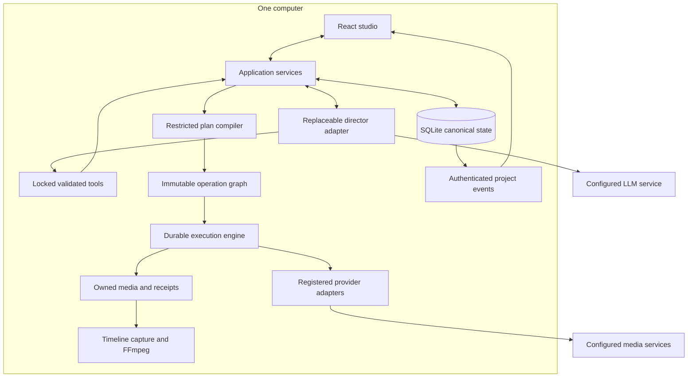

# OpenSlate architecture

OpenSlate is a single-user local video studio. The conversational director develops creative intent; the application preserves an editable production and executes selected media work. V0 supports resolved exports up to six minutes. Its browser, Fastify service, SQLite, artifacts, workers and native Codex run on one computer. Cloud model APIs remain supported; multi-host deployment and remote GPU workers are outside this version.

## Capabilities and design choices

| Capability | Implemented design |
|---|---|
| Conversational filmmaking | A native/fake director reads saved brief, treatment, scenes, shots, media and pending decisions; compatible shipped guidance updates before eligible fresh native turns |
| Editable production | Stable identities and revision-checked commands preserve unaffected outputs across scoped edits; a resizable Director pane and safe Markdown support iteration |
| Declarative planning | Restricted TypeScript compiles into a durable graph; no generated JavaScript is evaluated |
| Human review | Exact generation permission, finite usage/spending allowance and returned-frame/motion approval govern media execution |
| Recovery | Service-issued intents/candidates/attempts, durable receipts and uncertain-submission handling survive interruption |
| Narration | Explicit silence, script-first or recording-first review and accepted short within-shot voiceover |
| Playback/export | Synchronized picture/narration/music preview and an exact local FFmpeg render manifest |
| Provider choice | Compact job-based settings, actual Director model choices and separately saved Director/media settings; immutable media definitions remain pinned |

These design choices address revision integrity, review and recovery. They do not by themselves establish commercial quality, speed superiority or complete live-provider acceptance.

## Ownership

| Owner | Source of truth |
|---|---|
| Application services | Human requests/scopes, creative commits, grants, settings and recovery release |
| SQLite store | Project/plan revisions, immutable decisions, attempts, receipts and event cursors |
| Director adapter | Conversation/runtime mechanics and creative proposals; no independent production authority |
| Compiler | Allowed declarations, exact bindings, graph consistency and reuse/replace impact |
| Execution engine | Ready-work admission, current-state checks, attempts, liabilities and recovery |
| Media services | Owned bytes, verified measurements, normalization and immutable output provenance |
| Browser | Display, drafting and authenticated human commands; caches are replaceable |

## Main loop

1. Save the human request, scope and edit holds; revoke incompatible older director authority.
2. Read current saved evidence and gaps. The director proposes creative changes and a plan through locked typed tools.
3. Prepare without media effects: validate the mutation footprint, workflow prerequisites, source graph and reuse impact.
4. Apply against current revisions and request authority. Publish compatible creative/plan changes atomically.
5. Workers admit only eligible operations. The application checks one-use generation origin, exact reviews, allowances, holds, timing and current selection.
6. Retain provider receipts and outputs durably. Poll/recover the existing job; an uncertain effect is not a retry instruction.
7. Show the next useful decision, inspect actual frames/motion and audition the timeline. Scoped revisions preserve valid branches and historical attempts.

A project revision, a compiled plan, a creative candidate, a provider attempt and a selected artifact are different identities. A retry remains attached to its candidate; a new creative alternative needs its own human origin. Conversation resets do not reset those records.

## Current limits

- One active director turn per project; independent media operations can proceed within saved concurrency limits.
- 30 fps picture and 48 kHz audio in the local assembly path, up to 360 seconds/64 cuts/65 audio placements, with eight simultaneous mixing lanes.
- Within-shot voiceover may be shorter than picture; undecided narration is not silently treated as silence.
- Video normalization removes embedded generated sound. Accepted narration and optional owned music supply the soundtrack.
- Existing eligible OpenAI custom voice IDs are supported; in-app enrollment from a recording is pending.
- Local source-checkout launch, private same-root backups and recovery are implemented. Portable relocation, installer packaging, advanced timeline editing and same-machine H3 inference remain later work.

See [studio behavior](STORYBOARD-STUDIO.md), [component references](../technical/README.md), [current evidence](../implementation/STATUS.md) and the [accepted runtime trust boundary](../implementation/RUNTIME-TRUST-DECISION.md).
